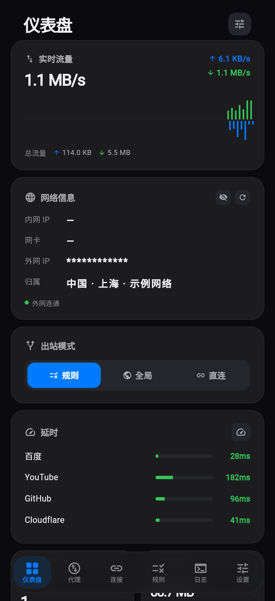
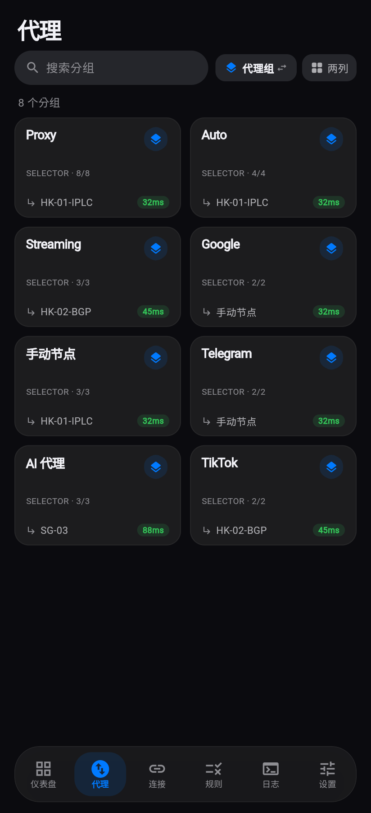
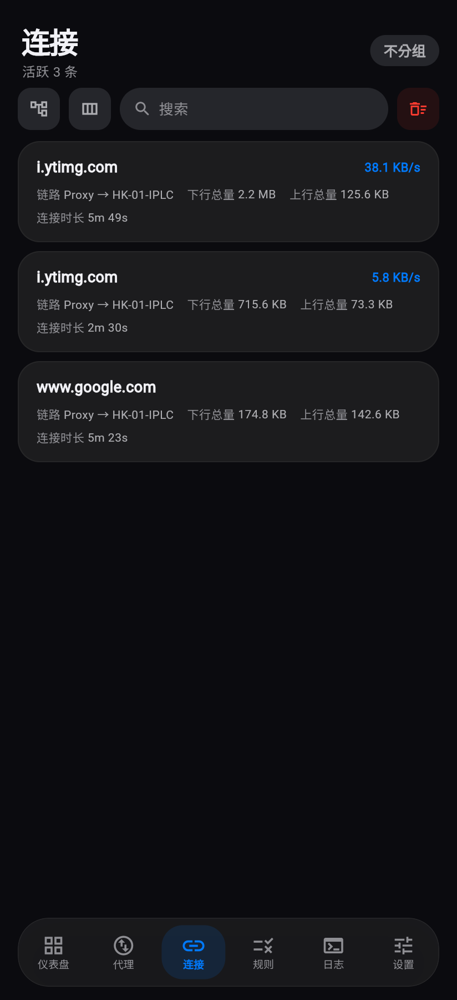
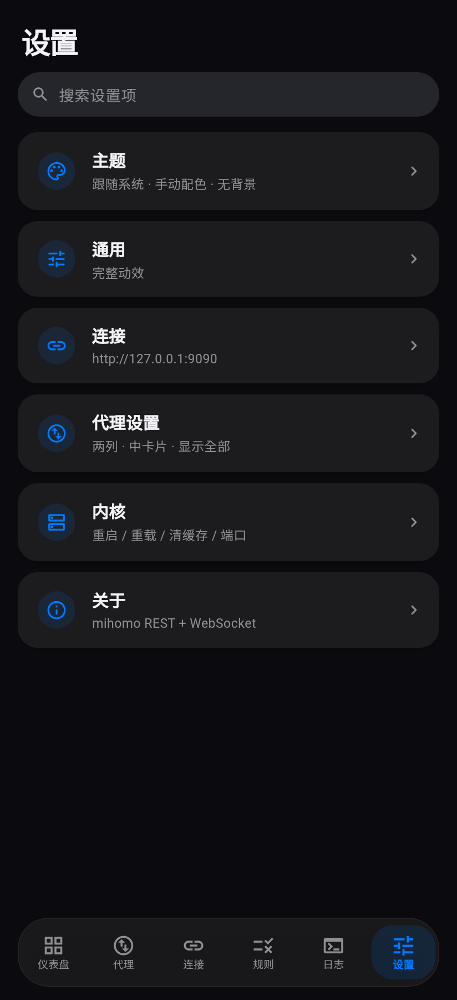

<p align="center">
  
</p>

<h1 align="center">Glimpse</h1>

<p align="center">
  一个为 mihomo（Clash Meta）打造的原生风控制台<br/>
  <i>A native-feeling console for mihomo (Clash Meta)</i>
</p>

<p align="center">
  纯 Flutter 自绘 · 无 WebView · 启动即用
</p>

<p align="center">
  
  
  
  
</p>

---

## 功能

### 仪表盘
- 实时上下行速度（点阵频谱 / 块状 / 折线三种图形，可自定义配色）
- 网络信息（外网 IP、归属地、内网 IP、网卡），**一键打码隐藏 IP**
- 出站模式切换（规则 / 全局 / 直连）
- 延时测试（可达性检测，失败自动跳过）
- 连接统计、内核内存占用（心率式折线）
- 卡片可自由排序、隐藏

### 代理
- 分组卡片：组名、LOGO、类型、**可用节点数/总数**、当前节点、延时角标
- 点击延时角标即可测速：分组测整组、节点测单个，测得一个填一个
- 节点悬浮窗：按列数网格布局，窗口高度随节点数量自适应
- 支持多级嵌套分组（套娃），分组延时会顺着链找到真实出口节点
- 代理提供商（机场）页：订阅用量条、到期时间、**可用节点比例条 + 中位延时**
- 排序：分组与节点**分开设置**（配置顺序 / 名称 / 延时）
- 可选「按机场分组」显示节点
- 自动组（url-test / fallback）手动指定节点后显示 🔒 标记，重新测速即恢复自动

### 连接
- 实时连接列表（按建立时间倒序，新连接永远在最前）
- 按规则 / 进程 / 主机分组，字段可自定义
- 单个连接详情，可断开

### 规则
- 完整规则列表，序号 + 命中流量（↑↓ 合计）+ 目标策略
- 每条规则可本地停用（视觉标注）
- 规则集供应商：behavior、规则条数、更新时间，可手动更新

### 日志
- 实时日志流，级别过滤、暂停、搜索、清空

### 设置
- **多后台**：可保存多个控制器地址与密钥，一键切换，支持编辑/删除
- 测速方式：App 指定 URL 测试 / 交给内核按配置测试
- 主题：深浅色、壁纸取色、强调色、**页面配色（6 套预设 + 色盘自定义）**
- 字体：字体族、正文字号、标题字号（独立缩放）
- 圆角、不透明度、磨砂、背景图与模糊
- 中英文界面（部分覆盖）
- 连接诊断、内核重启 / 重载 / 清 DNS / 清 FakeIP / 更新 GEO

---

## 技术栈

| 层 | 选型 |
|---|---|
| UI | Flutter 3.50（`material_ui`），全自绘，无 WebView |
| 状态 | Riverpod 3.x |
| 网络 | dio（REST）+ web_socket_channel（`/traffic` `/memory` `/logs` `/connections`） |
| 存储 | shared_preferences |
| 平台 | Android（minSdk 24，targetSdk 36） |

### 实现要点

- **数据流健康**：三条实时流（traffic / memory / connections）带断线重连 + **静默看门狗**（15 秒无数据自动重建），避免内核半死连接导致界面冻结
- **累计流量**取自 `/traffic` 帧自带的 `uploadTotal` / `downloadTotal`，减少对连接流的依赖
- **性能**：页面切换用淡入 + 回弹（非滑动分页），减少双页同时绘制；卡片用细边框替代阴影；滑动期间不做布局动画
- **交互**：统一的 `JellyPress` 果冻反馈，覆盖所有可点元素

---

## 构建

```bash
# 环境：Flutter 3.50+ / JDK 17 / Android SDK 36
flutter pub get
flutter build apk --release --split-per-abi
```

产物在 `build/app/outputs/flutter-apk/`。

国内网络可用镜像：

```bash
export PUB_HOSTED_URL=https://pub.flutter-io.cn
export FLUTTER_STORAGE_BASE_URL=https://storage.flutter-io.cn
```

---

## 使用

1. 安装 APK（按 CPU 架构选择 `arm64-v8a` 即可，现代手机基本都是）
2. 确保 mihomo 内核已在运行并开启外部控制（`external-controller: 0.0.0.0:9090`）
3. 打开 App → 设置 → 连接 → 添加后台，填入 `http://127.0.0.1:9090` 与密钥
4. 返回即可看到分组与节点

> 若内核运行在本机，地址填 `127.0.0.1`；运行在路由器/NAS 则填对应 LAN 地址，并确保内核允许外部访问。

---

## 已知限制

- **不管理内核**：本 App 只做控制台，不负责启动/停止 mihomo、不提供 TUN、不内置订阅
- **节点地理位置**：内核 API 不返回节点服务器地址，无法做精确的 IP 地理定位（曾尝试地图功能，因无法准确而移除）
- **英文界面为部分覆盖**：主要页面与设置项已翻译，弹窗、提示等尚未完全覆盖
- **仅 Android**：未适配桌面/Web

---

## 致谢

- [zashboard](https://github.com/Zephyruso/zashboard) — 功能组织与数据展示方式的参考
- [mihomo](https://github.com/MetaCubeX/mihomo) — 内核与其 REST/WS API

## 许可

[MIT](LICENSE)
